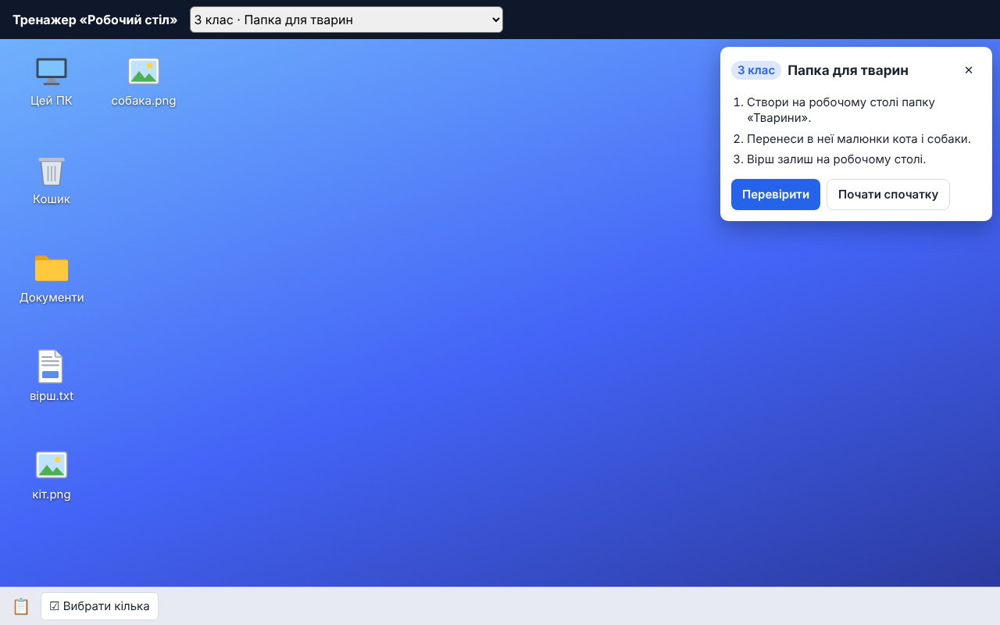

<h1 align="center">edu-desktop</h1>

<p align="center">
  <b>A Windows-like desktop simulator for teaching files, folders and windows in the browser.</b><br>
  Self-checking tasks, a replayable action log and server-side grading. Built for computer science lessons in grades 3–9.
</p>

<p align="center">
  <a href="https://github.com/zavada123/edu-desktop/actions/workflows/pages.yml"></a>
  <a href="https://zavada123.github.io/edu-desktop/"></a>
  <a href="LICENSE"></a>
  
  
</p>

<p align="center">
  <a href="https://zavada123.github.io/edu-desktop/"><b>Live demo</b></a> ·
  <a href="https://github.com/zavada123/edu-desktop/actions/workflows/pages.yml"><b>CI &amp; deploys</b></a> ·
  <a href="#installation">Installation</a> ·
  <a href="#usage">Usage</a> ·
  <a href="#api">API</a>
</p>

<p align="center">
  <a href="https://zavada123.github.io/edu-desktop/"></a>
</p>

## Why

Students learn file management best by doing it, but a real computer is hard to reset, hard to check and not available on every phone. `edu-desktop` gives every student the same familiar desktop in a browser tab. The task describes the starting files and the conditions to meet; the trainer checks the result and tells the student what is still wrong.

The student-facing interface is in Ukrainian. It was built for [EduProstir](https://eduprostir.com), a Ukrainian learning platform.

## Features

- **A familiar desktop:** icons, Explorer windows, a taskbar, the Recycle Bin and "This PC" with drives C: and D:.
- **Windows-style address bar:** click the empty space to see the full path (`D:\Мої уроки\Інформатика`), type a path and press Enter.
- **All the file operations from the curriculum:** New → Folder / Text document, rename, copy, cut, paste, delete, restore from the bin, delete permanently, empty the bin, with a "Move to Recycle Bin?" confirmation.
- **Shortcuts:** "Create shortcut" and "Send to → Desktop (create shortcut)"; a shortcut opens its target, and deleting it leaves the target alone.
- **ZIP folders:** "Send to → Compressed (zipped) folder", open an archive like a folder, "Extract all…".
- **Apps with Save As and Open dialogs:** Paint (you can draw), a text editor and a browser with "Save image as…".
- **Real Windows interactions:** right-drag menu (copy here / move here / create shortcuts), slow second click to rename, Ctrl/Shift multi-select, drag to a folder or the bin, minimise / maximise / close.
- **Keyboard shortcuts:** Ctrl+C, Ctrl+X, Ctrl+V, Ctrl+A, Delete, F2, Enter, Backspace, Escape. They work with the Ukrainian keyboard layout too.
- **Windows naming rules:** forbidden characters, reserved names (NUL, PRN, CON…), "Нова папка (2)", "море – копія.jpg".
- **Works on phones and tablets:** long press opens the context menu, a "Select several" button replaces Ctrl+click.
- **Large mode** for grades 3–4.
- **Tamper-proof grading:** the server replays the student's action log and checks the goals itself.

## Installation

The package is installed straight from GitHub. The built package is committed in `lib/`, so nothing is compiled on install.

```bash
npm install github:zavada123/edu-desktop#<commit>
```

Pin a specific commit, so that an update of the trainer never changes how tasks you have already given out are graded.

Peer dependencies: `react` and `react-dom` 19 or newer.

## Usage

### Describe a task

A task is a `Scenario`: what is on the desktop at the start, and which conditions to check at the end. No code is needed.

```ts
import type { Scenario } from "edu-desktop/core"

const animals: Scenario = {
  id: "g3-folder-animals",
  grade: 3,
  title: "Папка для тварин",
  large: true,
  task: ["Створи на робочому столі папку «Тварини».", "Перенеси в неї малюнки кота і собаки."],
  // An object is a folder, null is a file, a string is a shortcut to that path.
  // A folder whose name ends in .zip is a compressed folder.
  start: { "кіт.png": null, "собака.png": null, Документи: {} },
  // Optional: drive contents under "This PC". Goals refer to them as "D:/Мої уроки/...".
  drives: { "D:": { "Мої уроки": {} } },
  goals: [
    { type: "exists", path: "Тварини", kind: "folder" },
    { type: "exists", path: "Тварини/кіт.png", kind: "file" },
    { type: "count", folder: "Тварини", ext: "png", equals: 2 }
  ]
}
```

Set `app: { kind: "paint" }` (or `"text"`, `"browser"`) to open an app with Save As / Open dialogs for the task.

### Render the trainer

```tsx
import { EduDesktop } from "edu-desktop/react"
import "edu-desktop/style.css"

// Self-check: the student presses «Перевірити» (Check) inside the trainer.
<EduDesktop key={scenario.id} scenario={scenario} onCheck={(solved) => console.log(solved)} />

// Server-side check: the page stores the action log and submits it as the answer.
<EduDesktop key={scenario.id} scenario={scenario} selfCheck={false} initialOps={savedOps} onChange={setOps} />
```

### Grade on the server

The trainer records every successful change as an `Op`: create, rename, move, copy, delete, restore, create shortcut, compress, extract, save, open. Object ids are stable, so the same log on the same scenario always produces the same tree. The server never trusts the browser: it builds the starting tree, replays the log and checks the goals.

```ts
import { grade } from "edu-desktop/core"

const result = grade(scenario, ops)
if (!result.ok) {
  // The log is forged or broken: the action at result.index is impossible.
} else {
  result.solved   // every goal is met
  result.results  // per goal: ok, text and hint
}
```

A log is limited to 1,000 actions, 1,000 objects at a time and 5,000 objects created in total. A real task takes 10–60 actions.

### Build a starting desktop inside the trainer

Task authors can lay out the starting desktop in the trainer itself, then turn it into a tree description that `buildState` reads. The bin and the "opened" / "restored" marks are not included.

```ts
import { grade, toTreeSpec } from "edu-desktop/core"

const result = grade({ start, drives, goals: [] }, ops)
if (result.ok) {
  const { desktop, drives } = toTreeSpec(result.state)
}
```

## API

The package has two entry points.

| Entry point | Contents |
|---|---|
| `edu-desktop/react` | The `EduDesktop` component |
| `edu-desktop/core` | File system, goals, action log, `grade`, `toTreeSpec` and the built-in `scenarios`. No React, safe for Node |
| `edu-desktop/style.css` | Styles for the component |

### `<EduDesktop>` props

| Prop | Type | Description |
|---|---|---|
| `scenario` | `Scenario` | The task. To show another one, change the component `key` |
| `onCheck` | `(solved: boolean) => void` | Called after every press of «Перевірити» |
| `onChange` | `(ops: readonly Op[]) => void` | The full log of file-system changes, after every change |
| `initialOps` | `readonly Op[]` | A previously saved log: the student continues where they left off. An invalid log is ignored |
| `selfCheck` | `boolean` | `false` hides the Check button when your site grades the answer. Default `true` |

### Goals

Every goal accepts its own `text` and a `hint` shown when it is not met.

| `type` | Checks that |
|---|---|
| `exists` | A folder, file or ZIP folder (`kind: "zip"`) exists at the path |
| `absent` | Nothing exists at the path |
| `inBin` | An object with this name is in the Recycle Bin |
| `shortcut` | The folder holds a shortcut (any name) that opens the given object |
| `opened` | The file was opened in an app with File → Open |
| `restored` | The object was deleted to the bin and restored |
| `count` | The folder holds exactly N objects (optionally only folders, only files, or files with an extension) |

## Development

```bash
npm install
npm run dev        # demo at http://localhost:5173
npm test           # core tests (Vitest)
npm run build      # type check and build the demo into dist/
npm run build:lib  # build the package into lib/ (commit lib/ with your changes)
```

Every push to `main` runs the tests and deploys the demo to GitHub Pages: see the [workflow runs](https://github.com/zavada123/edu-desktop/actions/workflows/pages.yml).

## License

[MIT](LICENSE). All icons are drawn in this project (`src/ui/icons.tsx`); no Windows logos, icons, wallpapers or sounds are used. This project is not affiliated with Microsoft.
